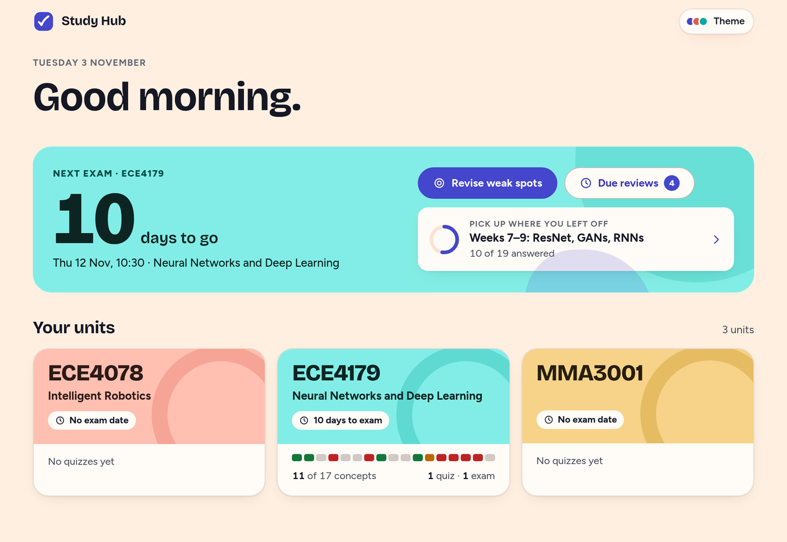
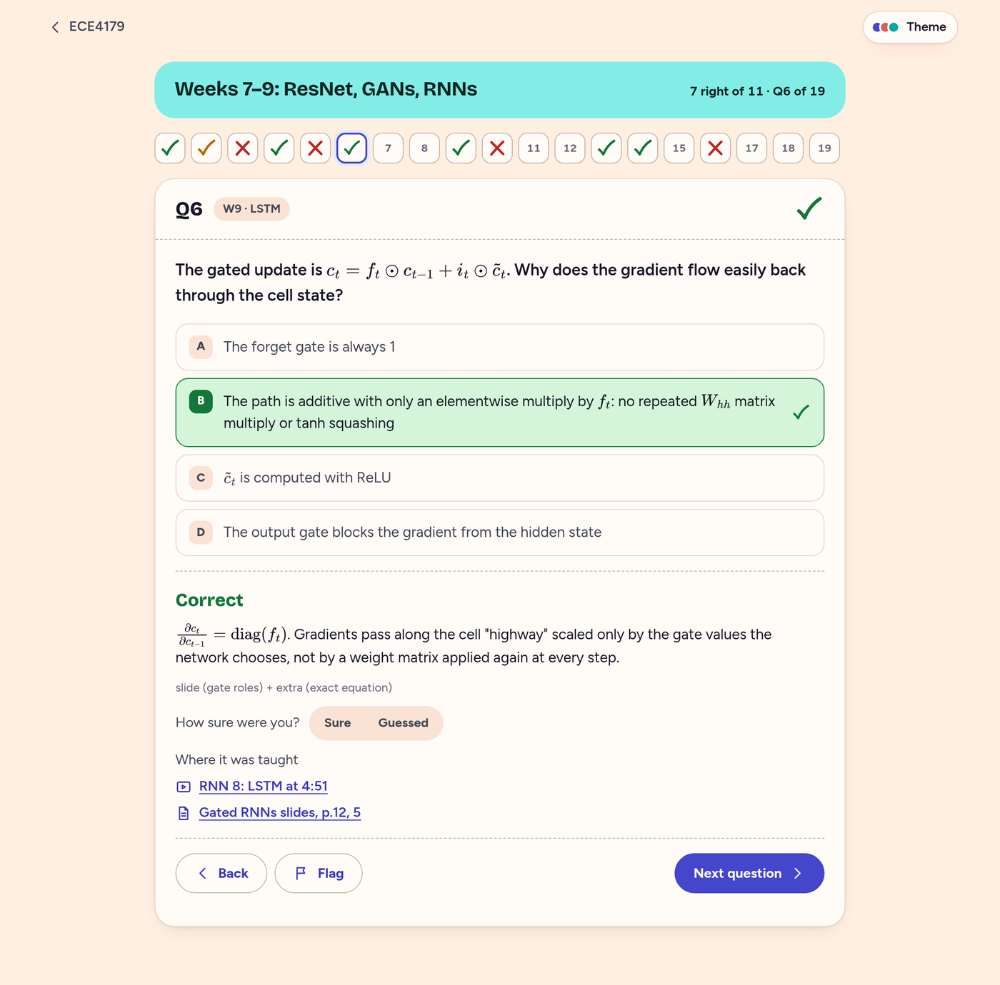

# ma-study

Exam-study skills for Monash students, shared within Monash Automation. Made by Sam Roberts with Claude.

- **ma-study-notes** reads a unit's Moodle page, the slides and worksheets on Google Drive, and Ed threads, then writes one notes file per week.
- **ma-study-quiz** quizzes you on those notes in an interactive Study Hub, with rendered maths, links back to the lecture video and slide, spaced repetition and weak-spot revision.

| Every answer explains itself and links to the lecture moment and slide | Progress by week and concept shows what needs work |
|---|---|
|  |  |

## Install

1. Get the [Claude desktop app](https://claude.ai/download) and open the **Code** tab. (The Chat tab can't open Moodle or save notes.)
2. When it asks for a folder, make a folder called `University` in your home folder and choose it.
3. Type: *"Install the ma-study plugin from github.com/samsamthecodingman/ma-study."* Then start a new session.
   (Or type this yourself: `/plugin install ma-study --marketplace samsamthecodingman/ma-study`)
4. In **Settings → Connectors**, add **Google Drive** and sign in with your Monash Google account.

## Use

Type `/ma-study`, or just say *"help me study for ECE4179"*. Claude opens Moodle for you to sign in, asks a couple of letter-answer questions, and builds the notes. Then say *"quiz me on weeks 7–9"*.

You'll see approval prompts while it works. They're safe to approve: it only reads Moodle, Drive and Ed, and saves notes into your `University` folder.

Building a whole unit uses a fair share of your Claude usage. If it stops partway, ask again and it carries on from where it stopped.
